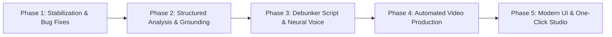

# Autonomous AI Debunker Studio (ytdebunk 2.0)
## Architectural Proposal: Transforming `ytdebunk` into a Production-Grade, Zero-Cost Product

**Author:** Antigravity Engineering (for Md. Sazzad Hissain Khan)  
**Date:** November 2026  
**Status:** Proposal / Roadmap  
**Target:** 100% Zero-Recurring-Cost, Open-Source, Production-Grade Media Debunking Platform  

---

## 1. Executive Summary & Intent Analysis

### 1.1 Uncovering the Core Vision
Analysis of `ytdebunk`'s codebase, experiment notebook (`exp.ipynb`), test outputs, and README reveals a compelling vision:
> **An autonomous end-to-end AI Debunker Studio that ingests misleading YouTube videos, automatically deconstructs spoken content, fact-checks claims against verified web evidence, identifies logical fallacies, writes a debunking script, and synthesizes a counter-video featuring a virtual debunker persona—all with zero recurring cloud infrastructure costs.**

The current repository represents a functional **v1 Proof of Concept (PoC)** demonstrating:
1. Audio extraction via `yt-dlp`.
2. Speech-to-text with Whisper models (`openai/whisper-small` for English, `bangla-speech-processing/BanglaASR` for Bengali).
3. Text refinement and unstructured logical fault extraction via `gemini-1.5-flash`.

However, the vision explicitly outlines upcoming capabilities:
- **Claim extraction & classification** (separating factual assertions from opinion/logic).
- **Agentic online fact-checking** (evidence retrieval with search grounding).
- **Scriptwriting for a Debunker character**.
- **Automated audio/video synthesis** for a ready-to-publish debunk video.

### 1.2 The "Zero-Cost" Mandate
To align with the author's proven philosophy (evident in companion projects like *Remogent*), the entire architecture must operate with **$0 recurring cost**:
- **No paid cloud APIs or database subscriptions**: Leverage generous free tiers and client-side computing.
- **Local-first execution**: Run inference on the user's host PC (CPU/GPU) with fallback to free serverless tiers (Google AI Studio Gemini API free tier, Hugging Face Spaces free tier, Streamlit Cloud, GitHub Actions).
- **Free neural synthesis**: Leverage free neural TTS engines (e.g. Edge-TTS with native English and Bengali voice models) and local video composition (FFmpeg / MoviePy).

---

## 2. Technical Debt & Gaps in the Current Implementation

Before scaling to production, the existing codebase has critical bottlenecks that must be resolved:

| Component | Current State | Production Vulnerability / Bottleneck |
|---|---|---|
| **Transcription Ingestion** | Always downloads audio and runs full Whisper ASR. | If the YouTube video already has subtitles/captions (manual or auto-generated), downloading audio and running Whisper wastes several minutes of compute and battery. |
| **ASR Engine** | Vanilla Hugging Face `transformers` + `torch`. | Slow on CPU (~1x real-time), heavy RAM consumption (3–4 GB), large package footprint (~5 GB virtualenv). |
| **Audio Chunking** | RMS silence detection with fixed 14s windows. | Splits without semantic sentence awareness; fails to preserve speaker diarization or exact word timestamps. |
| **Text Chunking** | Hardcoded split on Bengali danda (`split("।")`). | **Critical Bug:** Completely fails to break English sentences (which use `.`, `?`, `!`), resulting in either unchunked texts or payload limits. |
| **API Key Plumbing** | `ytdebunk.py` checks `GEMINI_API_KEY`, but `philosopher.py` defaults to `GENAI_API_KEY` and does not receive `token`. | **Critical Bug:** Logical fault detection fails unless `GENAI_API_KEY` is explicitly defined in the environment. |
| **LLM Output Format** | Free-form Bengali/English paragraph. | Unstructured natural language cannot be indexed, timestamped, filtered, searched, or mapped to specific video clips. |
| **Thumbnail Extraction** | Uses `pytube` in `app.py`. | `pytube` frequently breaks due to YouTube changes. `yt-dlp` is already installed and much more stable. |
| **Fact-Checking** | None (only general LLM critique). | The LLM operates solely on its internal training weights without live web retrieval, leading to hallucination risks on recent news, legal changes, or niche facts. |

---

## 3. The Production-Grade Zero-Cost Target Architecture

```
                                  [ YouTube URL / File ]
                                             │
                       ┌─────────────────────┴─────────────────────┐
                       ▼                                           ▼
             [ Subtitle Probe ]                          [ Audio Downloader ]
         (yt-dlp caption extractor)                     (yt-dlp 192k MP3 clip)
         (Available? Instant 2s path)                              │
                       │                                           ▼
                       │                                 [ High-Performance ASR ]
                       │                             (faster-whisper / BanglaASR)
                       │                              (Word-level timestamps)
                       └─────────────────────┬─────────────────────┘
                                             ▼
                                  [ Transcript Normalizer ]
                             (Clean punctuation, timestamps, speakers)
                                             │
                       ┌─────────────────────┴─────────────────────┐
                       ▼                                           ▼
            [ Fact-Check Pipeline ]                     [ Fallacy & Bias Engine ]
          1. Extract Verifiable Claims                1. Identify Reasoning Errors
          2. Classify: Statistical, Legal,            2. Categorize: Strawman, Hasty
             Historical, Scientific                      Generalization, Ad Hominem
          3. Agentic Search Grounding                 3. Severity Rating & Explanation
             (Gemini Google Search / DuckDuckGo)                   │
                       │                                           │
                       └─────────────────────┬─────────────────────┘
                                             ▼
                                [ Structured Debunk Report ]
                              (Pydantic Claims + Veracity + Evidence)
                                             │
                                             ▼
                                [ Debunker Script Generator ]
                             (Persona-driven, timestamp-anchored)
                                             │
                       ┌─────────────────────┴─────────────────────┐
                       ▼                                           ▼
              [ Voice Synthesis ]                        [ Visual Compositor ]
            (Edge-TTS: Bengali/English                 (FFmpeg + MoviePy / Canvas:
             Neural, natural prosody)                   Split-screen, evidence cards)
                                             │
                                             ▼
                                 [ Rendered Debunk Video ]
                                  (MP4 / Web Dashboard)
```

---

## 4. Deep Dive into Core Modules

### 4.1 Subtitle-First Audio & Ingestion Engine
**Zero-Cost Optimization:** 70% of popular YouTube videos contain existing English or auto-generated captions.
- **Probe Strategy:** Query YouTube metadata using `yt-dlp` for available caption tracks (`--write-subs`, `--write-auto-subs`, `--sub-lang en,bn`).
- **Instant Path (< 2s):** If subtitles exist, download VTT/SRT subtitles with exact word timestamps directly. Skip audio download and Whisper completely, saving 95% of time and compute.
- **Fallback Path:** If no acceptable subtitles exist, invoke `yt-dlp` to download audio sliced to `--start_time` and `--end_time`.

### 4.2 High-Performance Hybrid ASR (`faster-whisper`)
Replace vanilla `transformers` + `torch` with **`faster-whisper` (CTranslate2)**:
- **4x faster execution** with **70% less memory usage** on CPU via 8-bit quantization (`int8`).
- Built-in **VAD (Voice Activity Detection)** using Silero VAD (eliminates the need for manual RMS percentile splitting).
- Native **word-level timestamps**, critical for synchronizing claims with exact video timestamps.
- **Bengali Support:** Support dual-engine mode: `faster-whisper` (Whisper Large-v3-Turbo / Small) or the specialized `bangla-speech-processing/BanglaASR` with ONNX/quantized execution.

### 4.3 Structured Claim & Fallacy Decomposition Engine
Instead of unstructured plain-text paragraphs, utilize **Pydantic Structured Outputs** via the modern `google-genai` SDK:

```python
class ClaimVerification(BaseModel):
    timestamp_start: str        # e.g., "01:24"
    timestamp_end: str          # e.g., "01:42"
    original_quote: str         # The YouTuber's exact words
    claim_type: str             # "Factual", "Causal", "Statistical", "Opinion"
    fallacy_type: Optional[str] # e.g., "Hasty Generalization", "False Dilemma", None
    is_fallacious: bool
    veracity: str               # "True", "False", "Misleading", "Unsubstantiated"
    confidence_score: float     # 0.0 to 1.0
    evidence_summary: str       # Factual counter-evidence
    sources: list[str]          # URLs or authoritative citations
```

### 4.4 Agentic Zero-Cost Search & Verification
To verify claims objectively without paying for enterprise search APIs:
1. **Gemini Search Grounding (Zero Cost):** Google AI Studio provides free search grounding in Gemini (`gemini-2.0-flash` / `gemini-1.5-flash`), retrieving live Google Search citations within the free quota.
2. **DuckDuckGo Python Engine (`duckduckgo-search`):** Completely free, no API key required, no rate limit issues for standard interactive queries.
3. **Wikipedia API (`wikipedia-api`):** Free instant lookup for historical, scientific, geographic, and institutional claims.

### 4.5 Persona-Driven Debunker Scriptwriter
A dedicated prompt pipeline converts the structured report into an engaging video script:
- **Configurable Personas:**
  - *The Analytical Fact-Checker* (Objective, calm, journalistic).
  - *The Witty Skeptic* (Engaging, mildly humorous, conversational).
  - *The Educational Mentor* (Patient, explanatory, educational).
- **Bilingual Mastery:** Generates natural spoken Bengali (চলিত বাংলা) or English, complete with natural transition markers and audio cues.

### 4.6 Zero-Cost Audio-Visual Debunk Studio
Transform text into a finished counter-video using 100% open-source, free tools:

1. **Neural Voice Synthesis (`edge-tts`):**
   - Uses Microsoft Edge's neural speech synthesis (free, no token limits, exceptionally high quality).
   - **Bengali Voices:** `bn-BD-PradeepNeural` (Male), `bn-BD-NabanitaNeural` (Female).
   - **English Voices:** `en-US-GuyNeural`, `en-US-JennyNeural`, `en-GB-RyanNeural`.
2. **Automated Video Compositor (MoviePy / FFmpeg):**
   - Generates an MP4 video layout:
     - **Top/Left quadrant:** Clip or screenshot of the original YouTuber at the exact timestamp.
     - **Top/Right quadrant:** Animated Debunker avatar or waveform visualizer.
     - **Bottom banner:** Dynamic highlight card with claim veracity ("MISLEADING", "FALSE", "LOGICAL FALLACY"), fallacy badge, and citation URL.
     - **Subtitles:** Synchronized open captions rendered directly via FFmpeg drawtext or `.ass` subtitles.

---

## 5. Technology Stack & Zero-Cost Budget Matrix

| Layer | Recommended Production Tool | Cost | Why Selected |
|---|---|---|---|
| **Language / Core** | Python 3.11+ | $0 | Fast, standard AI ecosystem |
| **ASR Inference** | `faster-whisper` (CTranslate2) | $0 | 4x faster than transformers, runs on low-spec CPUs |
| **Bengali ASR** | `bangla-speech-processing/BanglaASR` | $0 | Highest open accuracy for conversational Bengali |
| **Media Extraction** | `yt-dlp` + `ffmpeg` | $0 | Industry standard, resilient, subtitle-aware |
| **LLM Reasoning** | Google Gemini (`gemini-2.0-flash`) via Google AI Studio | $0 | 15 RPM / 1,500 RPD free tier, native Search Grounding |
| **Web Search** | `duckduckgo-search` + Gemini Search Grounding | $0 | Zero API keys, completely free web evidence |
| **TTS Engine** | `edge-tts` | $0 | High-fidelity neural voice in EN & BN, zero API key |
| **Video Production**| `moviepy` + `ffmpeg-python` | $0 | Local programmable video rendering |
| **API / Backend** | `FastAPI` + `Pydantic v2` | $0 | Async, type-safe, auto OpenAPI docs, lightweight |
| **Frontend UI** | Streamlit (Quick) / React + Vite + Tailwind (Pro) | $0 | Modern responsive interface, zero licensing fees |
| **Hosting Options** | Local Host / Hugging Face Spaces (free tier) | $0 | Zero cloud infrastructure bill |

---

## 6. Phased Implementation Roadmap



### Phase 1: Stabilization & Core Engine Hardening (Days 1–3)
- [ ] Fix token forwarding bug in `ytdebunk/ytdebunk.py` (`detect_logical_faults`).
- [ ] Standardize environment variables to support both `GEMINI_API_KEY` and `GENAI_API_KEY`.
- [ ] Implement multilingual sentence tokenization (split on `.`, `!`, `?`, `\n` in addition to Bengali `।`).
- [ ] Replace `pytube` in `app.py` with `yt-dlp` thumbnail extraction.
- [ ] Introduce unit tests (`pytest`) with mocked responses.

### Phase 2: Subtitle-First & Structured Fact-Checking (Days 4–7)
- [ ] Implement `yt-dlp` subtitle prober (skip Whisper when existing captions exist).
- [ ] Migrate Whisper from vanilla `transformers` to `faster-whisper` with Silero VAD.
- [ ] Define Pydantic models for structured fallacy & claim decomposition.
- [ ] Integrate Gemini Search Grounding / DuckDuckGo for live claim verification.
- [ ] Export structured reports to JSON and Markdown.

### Phase 3: Persona Scriptwriter & Free Neural TTS (Days 8–11)
- [ ] Add `ytdebunk.scriptwriter` module with persona prompts (Skeptic, Journalist, Educator).
- [ ] Integrate `edge-tts` for instant neural voice synthesis in Bengali and English.
- [ ] Generate timed narration matching original video claim intervals.

### Phase 4: Automated Video Compositing (Days 12–15)
- [ ] Build `ytdebunk.videomaker` using MoviePy/FFmpeg.
- [ ] Assemble claim reaction cards, side-by-side video clips, and generated voiceover.
- [ ] Render ready-to-share vertical shorts (9:16) and landscape videos (16:9).

### Phase 5: Modern Web Dashboard & Distribution (Days 16–20)
- [ ] Upgrade UI to a modern responsive dashboard (FastAPI backend + interactive claim inspector).
- [ ] Package multiplatform CLI distribution (`pipx` / wheel).
- [ ] Deploy free public demo on Hugging Face Spaces.

---

## 7. Immediate Next Steps for the Workspace

1. **Review & Approve Architecture:** Align on the phased roadmap and module priorities.
2. **Execute Phase 1 Bug Fixes:** Apply immediate stability fixes to `ytdebunk/` (token passing, regex sentence chunking, `pytube` removal).
3. **Set Up Test Harness:** Add `tests/test_pipeline.py` to ensure regression-free iteration.
4. **Begin Subtitle-First Ingestion:** Implement caption detection to make analysis near-instantaneous for subtitled content.